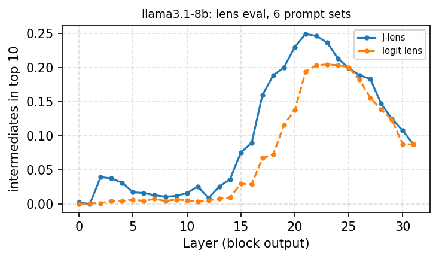

# 01 · Lens quality: J-lens vs logit lens

**Question.** Does the Jacobian lens surface intermediate concepts that the logit lens misses? This replicates
the lens evaluation of Gurnee et al. (2026) with Neuronpedia's pre-fitted lenses.

```bash
python experiments/01_lens_eval/lens_eval.py --model llama3.1-8b   # ~1 min on an M5 Max after loading
```

Outputs: `results/<model>.csv` (pass@1 and pass@10 per prompt set), `results/<model>_by_layer.csv`
(fraction of intermediates in the top 10 at each layer), `figures/<model>.{pdf,png}`.

## Method

Six prompt sets from the reference code (`data/`, copied from `anthropics/jacobian-lens` at commit `581d398`,
Apache-2.0): multihop, multilingual, order-ops, poetry, association, typo. Each item names intermediate concepts
that never appear in the prompt, e.g. "Brazil" in *"The ocean on the coast of the country where Carnival is most
famously celebrated is the"*.

For each intermediate, the rank in the lens readout over the full vocabulary is taken at its best layer; pass@k
is the fraction of intermediates with rank ≤ k, averaged over items. The readout is at the last prompt token,
except for poetry, which reads at the newline ending line 1 (as in the reference code's
`data/evaluations/README.md`). A word's rank is the best over the first tokens of "word" and " word"; for
order-ops, over single-token synonyms (digits and number words, symbols and operation words; these lists are
ours).

## Results

**Llama-3.1-8B** (`results/llama3.1-8b.csv`):

| Prompt set | pass@1 J-lens | pass@1 logit lens | pass@10 J-lens | pass@10 logit lens |
|---|---|---|---|---|
| multihop | 0.301 | 0.237 | 0.613 | 0.505 |
| multilingual | 0.271 | 0.273 | 0.535 | 0.432 |
| order-ops | 0.127 | 0.009 | 0.427 | 0.145 |
| poetry | 0.010 | 0.031 | 0.061 | 0.041 |
| association | 0.039 | 0.039 | 0.137 | 0.098 |
| typo | 0.271 | 0.135 | 0.708 | 0.438 |
| **macro** | **0.170** | **0.121** | **0.414** | **0.277** |

The J-lens advantage is in layers 15–23 (peak at layer 21: 0.25 vs 0.19 of intermediates in the top 10).



**GPT-2 small:** both lenses are near the floor (macro pass@10 0.139 J-lens vs 0.171 logit lens).

## Other models

pass@10, J-lens / logit lens (`results/<model>.csv`; Qwen3-8B and OLMo-3-7B with transformers 5.11):

| Prompt set | Llama-3.1-8B | Llama-3.1-8B-Instruct | Qwen3-8B | OLMo-3-7B |
|---|---|---|---|---|
| multihop | 0.613 / 0.505 | 0.570 / 0.586 | 0.511 / 0.516 | 0.532 / 0.514 |
| multilingual | 0.535 / 0.432 | 0.523 / 0.425 | 0.432 / 0.437 | 0.465 / 0.467 |
| order-ops | 0.427 / 0.145 | 0.345 / 0.118 | 0.327 / 0.191 | 0.382 / 0.200 |
| poetry | 0.061 / 0.041 | 0.122 / 0.163 | 0.000 / 0.000 | 0.031 / 0.041 |
| association | 0.137 / 0.098 | 0.196 / 0.127 | 0.000 / 0.020 | 0.039 / 0.059 |
| typo | 0.708 / 0.438 | 0.771 / 0.490 | 0.208 / 0.583 | 0.677 / 0.469 |
| **macro** | **0.414 / 0.277** | **0.421 / 0.318** | **0.246 / 0.291** | **0.354 / 0.292** |

- The J-lens advantage replicates on Llama-Instruct and OLMo, carried by `order-ops` and `typo`. On multihop it
  is gone in every model except base Llama.
- **Qwen3-8B is the exception**: the J-lens loses on macro, mostly on `typo` (0.208 vs 0.583). The lens itself
  works on Qwen in experiments 04 and 06 (it reads the intermediate country and the true continent better than
  the logit lens), so this looks like a property of these prompt sets on Qwen, not a broken lens; worth a closer
  look (the lens file has finite J's of normal scale, and our code applies it as the reference code does).
