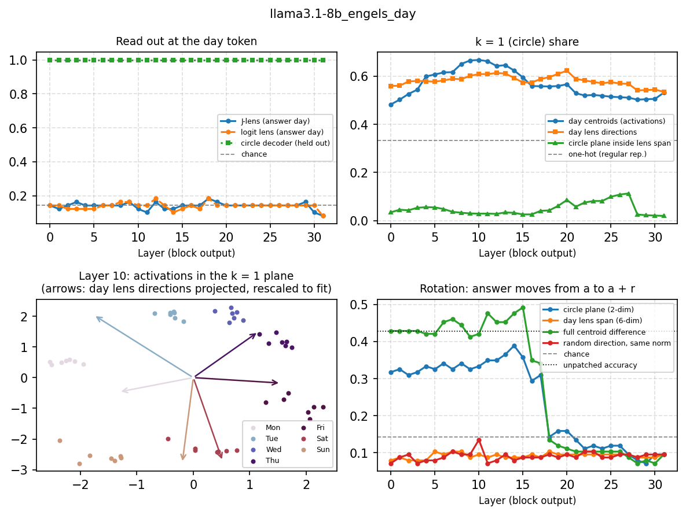
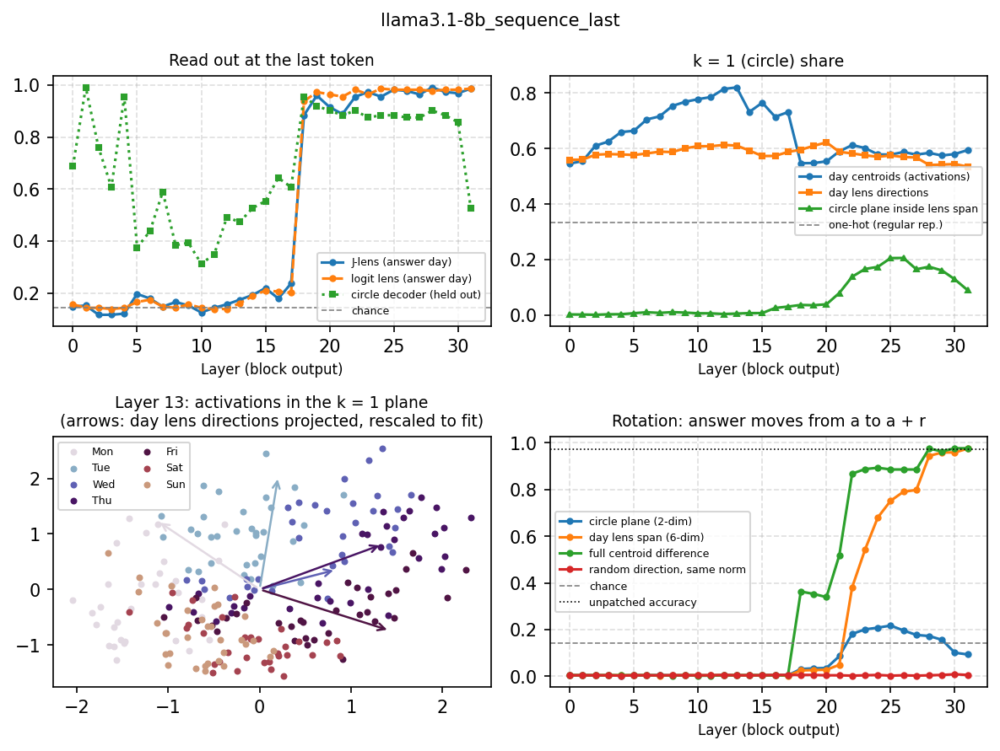

# 02 · The weekday circle through the J-lens

**Question.** Engels et al. (2025) showed that days of the week are represented on a circle (a
multi-dimensional, nonlinear feature) and that rotating that circle changes the model's answer. What does the
J-lens see of that circle, and where is each one causal?

```bash
python experiments/02_weekday_circle/weekday_circle.py --model llama3.1-8b --task engels --position day
```

`--task sequence|engels` and `--position last|day`; `bash run_all.sh <model>` runs all four combinations. On an
M5 Max with Llama-3.1-8B: ~20 min per `sequence` run, ~5 min per `engels` run. Outputs:
`results/<model>_<task>_<position>_layers.csv` (one row per layer), `..._rotation.csv` (one row per layer, shift
and patch), `figures/<model>_<task>_<position>.{pdf,png}`.

## Setup

| Task | Prompt | Prompts | Held out |
|---|---|---|---|
| `sequence` | *"&lt;prefix&gt; Tuesday, Wednesday,"* → Thursday (8 prefixes of ≥ 16 tokens, 1–4 listed days, 7 starting days) | 224 | prefixes 1, 3, 5, 7 |
| `engels` | *"Let's do some days of the week math. Two days from Monday is"* (Engels et al.; 7 days × durations 1–7) | 49 | durations 2, 4, 6 |

Position `day` is the last day named in the prompt (Engels' `a_token`, position 14 in his prompt); there the day
centroids are grouped by that day. Position `last` is the final token (the comma, or " is"); there they are
grouped by the answer day.

At every layer the script measures:

- **Circle share:** the fraction of the day centroids' variance in the k = 1 Fourier mode (irreps of Z/7).
  A pure circle gives 1.00; seven unrelated directions (one-hot) give 0.33.
- **Lens readout:** whether the J-lens and the logit lens pick the answer day among the seven days, and its rank
  in the full vocabulary.
- **Circle plane in lens span:** how much of the k = 1 plane of the activations lies in the 6-dim span of the
  J-lens directions of the seven day tokens (0 means orthogonal). The lens direction of token *t* at layer *l* is
  the row of *W_U diag(g) J_l* for *t*, with g the final norm's gain.
- **Rotation:** add P(c<sub>d+r</sub> − c<sub>d</sub>) after block *l* at that position, where c<sub>j</sub> is
  the training centroid of day *j* and P a projection, and count how often the answer moves from *a* to *a + r*
  (averaged over r = 1, …, 6; chance is 1/7). P is the circle plane (2-dim), the day lens span (6-dim), or
  the identity (full centroid difference); the control is a random direction with the circle patch's norm.

## Results (Llama-3.1-8B)

The model solves 98.7% of the `sequence` prompts but only 51% of Engels' prompts (43% of the held-out ones).
The table therefore counts moves only on held-out prompts the model solves without intervention (column
`moved_if_correct_unpatched` of the rotation CSVs; `moved_to_target` uses all held-out prompts). Each cell is
the range over the layers of the band.

| Config | Layers | Circle plane (2-dim) | Day lens span (6-dim) | Full centroid difference | Random direction |
|---|---|---|---|---|---|
| `engels`, `day` | 0–17 | 0.31–0.46 | 0.00–0.02 | 0.48–0.72 | 0.00–0.02 |
| | 18–31 | 0.00–0.13 | 0.00–0.02 | 0.00–0.13 | 0.00–0.02 |
| `sequence`, `day` | 0–17 | 0.12–0.24 | 0.00 | 0.74–0.89 | 0.00 |
| | 18–31 | 0.00–0.05 | 0.00 | 0.00–0.28 | 0.00 |
| `sequence`, `last` | 0–17 | 0.00 | 0.00 | 0.00 | 0.00 |
| | 18–31 | 0.03–0.21 | 0.02–0.97 | 0.34–0.98 | 0.00 |
| `engels`, `last` | 0–17 | 0.00–0.02 | 0.00–0.02 | 0.00–0.06 | 0.00–0.02 |
| | 18–31 | 0.06–0.26 | 0.00–0.37 | 0.06–0.37 | 0.00–0.02 |

- **At the day token**, the circle plane carries the answer in layers 0–17 (in Engels' prompt, 0.31–0.46 of the
  solved prompts move) while the day lens span does no better than a random direction, and less than 6% of the
  circle plane lies in that span. The effect collapses at layer 18 (circle plane ≤ 0.13 from there on), as in
  Engels et al.'s Fig. 6.
- **At the last token** of the `sequence` task, the answer-day centroids form a circle that peaks at layer 13
  (share 0.82) and drops to 0.55 at layer 18, the layer where both lenses start reading the answer (top-1 among
  the days: 0.88 J-lens, 0.94 logit lens). At layers 16–17 the J-lens already ranks the answer 4th in the full
  vocabulary (median), against thousands for the logit lens.
- Patching the last token does nothing before layer 18: the answer is still being computed at earlier positions.
  Late, the lens span carries the answer (0.95–0.97 at layers 28–31) and the circle plane at most 0.21.

So the J-lens finds where the answer becomes *verbalizable*, not where it is *computed*: the lens directions of the
day tokens miss a feature that is two-dimensional and circular.





**GPT-2 small** solves the `sequence` task (95%) but not Engels' prompt (14%, chance), so its `engels` results
are not meaningful.

**Llama-3.1-8B-Instruct** (`engels`, `day` only): it solves 37% of Engels' prompts (8 of the 21 held-out ones).
In layers 0–17 the circle plane moves 0.27–0.42 of the solved prompts, the full centroid difference 0.48–0.62,
and the day lens span and random directions at most 0.02; from layer 18 on, all of them at most 0.19. The same
picture as the base model.

**Qwen3-8B** (`engels`, `day`; 36 layers, transformers 5.11): it solves 57% of Engels' prompts (10 of the 21
held-out ones). In layers 0–22 the circle plane moves 0.17–0.25 of the solved prompts, the full centroid
difference 0.52–0.65, the day lens span 0.00 and random directions at most 0.05; from layer 23 on, everything
at most 0.08. Same picture, with the hand-off at layer 23 (of 36) instead of 18 (of 32), and a weaker circle.

**OLMo-3-7B** (`engels`, `day`; transformers 5.11): it solves 71% of Engels' prompts (15 of the 21 held-out
ones). In layers 0–18 the circle plane moves 0.26–0.41 of the solved prompts, the full centroid difference
0.59–0.87, the day lens span 0.00 and random directions at most 0.01; from layer 19 on, everything at most
0.09. Four models, same picture: the circle carries part of the answer at the day token, the day lens
directions none.

## Caveats

- Lens readouts at Engels' day token (position 14) are outside the lens fit, which skipped the first 16
  positions. The rotation does not use the lens.
- The circle plane, the centroids and the lens span are estimated on the training prompts and evaluated on the
  held-out ones, but the held-out sets are small (Engels: 21 prompts, 9 solved).
