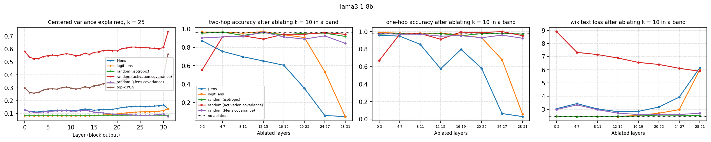
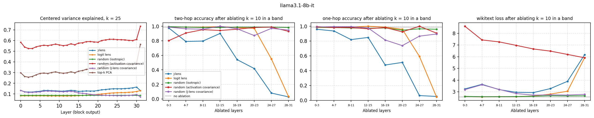

# 03 · How much of the residual stream is J-space?

**Question.** Gurnee et al. (2026) define the J-space at a layer as the sparse nonnegative combinations of J-lens
vectors (the rows of *W_U diag(g) J_l*, one per token), and report that (i) the J-space component carries
"never more than 10%" of the activation variance and (ii) ablating it in a band of layers destroys multi-hop
reasoning while MMLU stays intact. Is 10% small compared with what any dictionary of 128k directions would
capture? And does the ablation result hold on an open model, against controls?

```bash
python experiments/03_jspace/jspace.py --model llama3.1-8b
```

Outputs: `results/<model>_variance.csv` (layer × dictionary × k), `results/<model>_ablation.csv`
(band × dictionary × k), `figures/<model>.{pdf,png}`.

## Method

- **Decomposition** (`jlens_open/jspace.py`): nonnegative orthogonal matching pursuit. Each step adds the unit
  atom most aligned with the residual and refits all coefficients by nonnegative least squares (the paper uses
  gradient pursuit, a faster approximation of the same).
- **Centering the lens vectors.** Adding one vector to every row of *W_U* does not change the softmax, so that
  shared component carries no readout. Uncentered, it dominates: in GPT-2 small, the unit J-lens vectors have
  cosine ≈ 0.99 with their mean, so they fill a narrow cone and nonnegative combinations of them explain
  almost nothing of the centered activations (< 1%). The main dictionaries are therefore centered over the
  vocabulary; the uncentered ones are reported too.
- **Dictionaries**, all with one atom per vocabulary token: J-lens, logit lens (J = I), random isotropic,
  random with the activations' covariance (the chance level for a dictionary aligned with where activations
  vary), and random with the J-lens vectors' covariance (same second moments as the J-lens dictionary, so the
  same directions of high downstream sensitivity, but no atom tied to a token). Top-k PCA is shown as a
  reference (one fixed subspace, not a per-token choice). `--dicts` recomputes only the named dictionaries and
  keeps the other rows of existing results (a partial run writes the same files as a full one).
- **Data:** mean-centered activations at positions ≥ 16 of 16 wikitext paragraphs (128 tokens each;
  `data/wikitext_sample.json`, wikitext-103 test split, CC BY-SA 3.0).
- **Ablation:** in a band of 4 layers, every position except BOS loses its k-atom component (k = 10, 25). Measured
  on two-hop prompts (*"… the official language of the country whose capital is Lima is"*), their one-hop
  controls (*"… the official language of Peru is"*: same answers, no intermediate entity; prompts in
  `jlens_open/facts.py`) and the wikitext next-token loss.

## Results (Llama-3.1-8B)

**Variance** (1,792 wikitext tokens per layer; layers 0–30, `results/llama3.1-8b_variance.csv`):

| Dictionary | k = 10 | k = 25 |
|---|---|---|
| J-lens | 0.07–0.11 | 0.11–0.17 |
| random, J-lens covariance | 0.04–0.08 | 0.09–0.13 |
| logit lens | 0.04–0.07 | 0.08–0.12 |
| random, isotropic | 0.04 | 0.09 |
| top-k PCA | 0.16–0.28 | 0.26–0.39 |
| random, activation covariance | 0.35–0.46 | 0.52–0.62 |

- The paper's "never more than 10%" holds: with k = 10 the J-space explains 7–11%. That is 1.8–2.8 times an
  isotropic dictionary but far below a random dictionary shaped like the activations (35–46%): the J-space is
  a small part of the residual stream, not where its variance is.
- Up to layer 14 the random dictionary with the J-lens covariance explains almost as much (within 4–20%: 0.06–0.08
  vs 0.07–0.08): there, the J-lens's edge over chance comes from its geometry. The gap opens from layer 15 and
  from layer 21 on the token-aligned atoms explain more than twice as much (0.10–0.11 vs 0.04–0.05).
- Llama's lens vectors do not fill a narrow cone (norm of the mean unit atom 0.15–0.34 uncentered, against 0.99 in
  GPT-2 small), so centering changes less here (uncentered J-lens: 0.05–0.10).

**Ablation** of the k = 10 component in a band of 4 layers (`results/llama3.1-8b_ablation.csv`). Unablated:
two-hop 0.95, one-hop 0.98, wikitext loss 2.44. Accuracy is among the 33 languages.

| Band | J-lens: two-hop / one-hop / loss | random, J-lens covariance | random, activation covariance |
|---|---|---|---|
| 0–3 | 0.89 / 0.95 / 3.03 | 0.90 / 0.97 / 2.98 | 0.65 / 0.79 / 8.99 |
| 4–7 | 0.73 / 0.91 / 3.41 | 0.92 / 0.97 / 3.33 | 0.78 / 0.98 / 7.48 |
| 8–11 | 0.67 / 0.87 / 3.01 | 0.94 / 0.97 / 2.99 | 0.91 / 0.98 / 7.16 |
| 12–15 | 0.67 / 0.64 / 2.82 | 0.98 / 0.93 / 2.72 | 0.89 / 0.95 / 6.92 |
| 16–19 | 0.60 / 0.82 / 2.84 | 0.90 / 0.97 / 2.60 | 0.92 / 0.98 / 6.49 |
| 20–23 | 0.32 / 0.59 / 3.16 | 0.87 / 0.92 / 2.61 | 0.95 / 0.98 / 6.39 |
| 24–27 | 0.05 / 0.06 / 3.94 | 0.92 / 0.97 / 2.60 | 0.97 / 0.99 / 6.15 |
| 28–31 | 0.05 / 0.03 / 6.20 | 0.82 / 0.92 / 2.67 | 0.95 / 0.97 / 5.91 |
| removed variance | 0.04–0.06 | 0.04–0.05 | 0.09–0.14 |

The logit-lens and isotropic dictionaries remove about as much variance as the J-lens (0.035–0.05) and change
little up to layer 23 (two-hop ≥ 0.91, loss ≤ 2.70).



- **The token-aligned atoms carry the facts.** The random dictionary with the J-lens covariance removes the same
  variance and raises the loss as much as the J-lens up to layer 15 (2.72–3.33 vs 2.82–3.41), yet two-hop stays
  at 0.90–0.98 where the J-lens ablation brings it to 0.60–0.73. What breaks recall is not removing variance in
  the directions the output is sensitive to, but removing the specific token directions.
- **Double dissociation with high-variance directions.** Removing 9–11% of the variance along random
  activation-shaped directions wrecks next-token prediction (loss 5.9–9.0) but leaves two-hop at 0.89–0.97 from
  layer 8 on. The J-space ablation does the opposite: small loss increase, recall broken.
- **Not specific to multi-hop.** The paper's result (multi-hop destroyed, MMLU intact) suggests a dissociation
  between multi-hop and direct recall; here one-hop recall also falls (0.64–0.91 in bands 4–19 at k = 10, and
  0.16–0.35 in bands 8–19 at k = 25, against two-hop 0.19–0.28). Two-hop is more fragile in 4 of the 5 middle
  bands, not categorically.
- In the last bands the J-lens approaches the logit lens (J → I), and removing the top tokens removes the
  answer itself.

## Results (Llama-3.1-8B-Instruct)

Unablated: two-hop 0.99, one-hop 0.99, wikitext loss 2.57. Variance explained with k = 10: J-lens 0.07–0.11,
J-lens covariance 0.04–0.08, isotropic 0.04, activation covariance 0.35–0.45 (layers 0–30). Ablation, k = 10
(two-hop / one-hop / loss):

| Band | J-lens | random, J-lens covariance | random, activation covariance |
|---|---|---|---|
| 0–3 | 0.98 / 0.96 / 3.25 | 0.99 / 0.99 / 3.19 | 0.80 / 0.99 / 8.60 |
| 4–7 | 0.79 / 0.94 / 3.64 | 0.97 / 0.99 / 3.61 | 0.91 / 0.98 / 7.43 |
| 8–11 | 0.80 / 0.82 / 3.19 | 0.96 / 0.99 / 3.21 | 0.95 / 0.98 / 7.27 |
| 12–15 | 0.90 / 0.85 / 2.96 | 1.00 / 0.98 / 2.85 | 0.94 / 0.97 / 6.97 |
| 16–19 | 0.54 / 0.48 / 2.93 | 0.97 / 0.81 / 2.72 | 0.96 / 0.98 / 6.66 |
| 20–23 | 0.42 / 0.51 / 3.28 | 0.87 / 0.74 / 2.74 | 0.98 / 0.92 / 6.48 |
| 24–27 | 0.08 / 0.06 / 3.90 | 0.97 / 0.87 / 2.73 | 0.99 / 1.00 / 6.19 |



The same dissociation as in the base model: up to layer 15 the J-lens-covariance control matches the J-lens
ablation's loss (2.85–3.61 vs 2.96–3.64) but leaves recall at 0.96–1.00, while the J-lens ablation brings two-hop
to 0.79–0.90 (and to 0.42–0.54 at layers 16–23). The instruction-tuned model is somewhat more robust in the early
bands.

## Caveats

- Accuracy is the argmax among the 33 languages, which can survive a broken full distribution (the activation
  covariance ablation).
- Nonnegative OMP with 150 projected-gradient steps approximates the paper's gradient pursuit; the components
  removed are the ones this algorithm finds.
