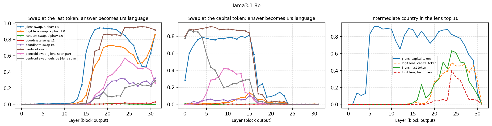
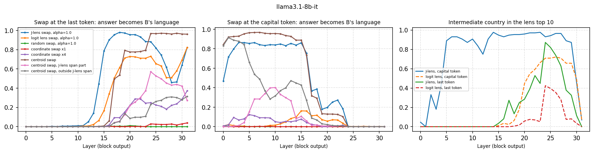
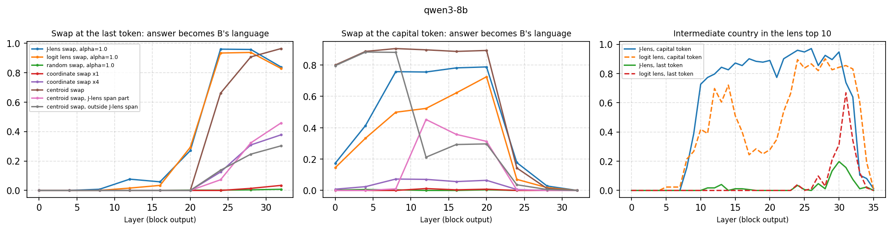
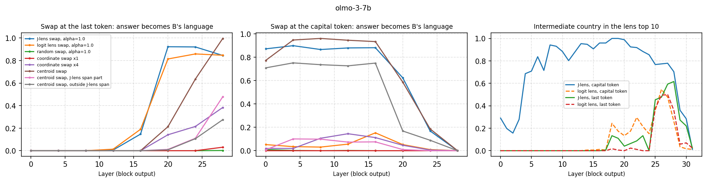

# 04 · Is the intermediate that the J-lens reads causally used?

**Question.** In *"The official language of the country whose capital is Lima is"*, the model needs the
intermediate "Peru". Gurnee et al. (2026) swap an intermediate's J-lens coordinate for another entity's and the
answer follows in 54–70% of trials on Claude models. Does that hold on an open model, and is it specific to
J-lens directions?

```bash
python experiments/04_multihop_swap/multihop_swap.py --model llama3.1-8b
```

Outputs: `results/<model>_swap.csv` (layer × position × patch), `results/<model>_readout.csv` (rank of the
intermediate country in each lens), `figures/<model>.{pdf,png}`.

## Method

172 prompts: 43 countries × 4 phrasings (`jlens_open/facts.py`). On prompts the model answers correctly (among the
languages), country A is replaced by a country B with another language, after block *l*, at the last token or at
the capital's last token; success = the answer becomes B's language.

| Patch | Displacement |
|---|---|
| J-lens swap | *s (v_B − v_A)*, unit J-lens vectors of " B" and " A" (centered over the vocabulary) |
| logit-lens swap | the same with logit-lens vectors |
| random swap | the same with two random unit vectors |
| coordinate swap (×1, ×4) | *c_A (v_B − v_A)*, *c_A* the coefficient of *v_A* in the k = 16 J-space decomposition (the paper's swap; zero when *v_A* is not among the 16 atoms) |
| centroid swap | *m_B − m_A*, mean activations over the other phrasings of each country's prompt; also its part in span(*v_A*, *v_B*) and the rest |

For the first three, *s = α · mean‖h − mean‖* at that layer and position, α ∈ {0.5, 1, 2}.

## Results (Llama-3.1-8B)

The model answers 95.3% of the 172 prompts correctly (among 33 languages); 492 swap trials. Success = fraction
of trials whose answer becomes B's language (`results/llama3.1-8b_swap.csv`), as a range over layers:

| Patch | Capital token, layers 1–15 | Last token, layers 15–26 |
|---|---|---|
| J-lens swap, α = 1 | **0.59–0.80** | **0.65–0.94** |
| logit-lens swap, α = 1 | 0.00–0.14 | 0.12–0.74 |
| logit-lens swap, α = 2 | 0.09–0.41 | 0.63–0.82 |
| random swap, α = 1 | 0.00 | 0.00–0.01 |
| centroid swap (full) | 0.82–0.91 | 0.02–0.95 (≥ 0.85 from layer 19) |
| … its part in span(*v_A*, *v_B*) | 0.00–0.44 | 0.00–0.57 |
| … its part outside | 0.20–0.87 | 0.01–0.21 |
| coordinate swap ×1 (paper) | 0.00 | 0.00–0.02 |



- **J-lens directions are causal for the intermediate.** At the capital token, replacing the J-lens vector of
  " Peru" by that of " Brazil" turns *Spanish* into *Portuguese* in up to 80% of trials; the same displacement
  along logit-lens vectors does almost nothing (≤ 0.14) and random directions nothing.
- **The country enters the J-lens span at layer 5.** At the capital token, the full centroid difference works
  from layer 0, but in layers 0–4 its part inside span(*v_A*, *v_B*) does nothing (≤ 0.03) and the part outside
  does it all (0.76–0.87). From layer 5 on, the inside part takes over (0.29–0.44 in layers 6–13) and the
  outside part falls (0.20–0.41). Layer 5 is also where the J-lens starts reading the country at the capital
  token (median rank 4, then 2; in the top 10 for 84–92% of prompts in layers 5–10), while the logit lens ranks
  it in the thousands or worse until layer 18.
- **The intermediate moves to the last token at layers 15–17**: swaps at the capital token stop working at
  layer 17, swaps at the last token start at 15 (J-lens) to 17 (centroid). A J-lens swap at the last token
  already works at layer 15 (0.65), before the country itself is there (centroid swap 0.02): downstream layers
  read country identity from J-lens directions.
- **Contrast with the weekday circle (experiment 02)**: there, the day lens span did nothing at the day token.
  Nameable entities live in the J-space; the circle used to compute day arithmetic does not.
- **The paper's coordinate swap fails here** because the country's atom is rarely among the 16 atoms of the
  nonnegative decomposition of the centered activation (≤ 13% of prompts at the capital token before layer 21,
  20–48% at the last token from layer 17), even though the lens ranks the country second. How the swap's
  strength is chosen matters; with a fixed norm (α), the J-lens direction works.

## Results (Llama-3.1-8B-Instruct, every second layer)

98.8% two-hop accuracy, 510 swap trials (`results/llama3.1-8b-it_swap.csv`).

| Patch | Capital token, layers 2–14 | Last token, layers 16–26 |
|---|---|---|
| J-lens swap, α = 1 | **0.79–0.86** | **0.75–0.98** |
| logit-lens swap, α = 1 | 0.00–0.10 | 0.34–0.73 |
| random swap, α = 1 | 0.00 | 0.00–0.01 |
| centroid swap (full) | 0.89–0.97 | 0.06–0.97 |
| … its part in span(*v_A*, *v_B*) | 0.01–0.40 (0.29–0.40 at layers 6–12) | 0.00–0.57 |



Instruction tuning changes none of the conclusions: the J-lens direction swap is causal and the logit-lens one is
not, the country enters the J-lens span at the capital token between layers 4 and 6 (in-span part 0.04 → 0.29;
J-lens median rank 13 → 2), and it reaches the last token at layers 16–18. The J-lens swaps are a little
stronger than in the base model (0.79–0.86 vs 0.68–0.78 at the capital token).

## Results (Qwen3-8B, 36 layers, every fourth layer)

95.9% two-hop accuracy, 495 swap trials (`results/qwen3-8b_swap.csv`; transformers 5.11).

| Patch | Capital token, layers 8–20 | Last token, layers 24–32 |
|---|---|---|
| J-lens swap, α = 1 | **0.76–0.79** | 0.84–0.96 |
| logit-lens swap, α = 1 | 0.50–0.73 | 0.83–0.94 |
| random swap, α = 1 | 0.00 | 0.00–0.01 |
| centroid swap (full) | 0.89–0.91 | 0.66–0.96 |
| … its part in span(*v_A*, *v_B*) | 0.01 at layer 8, 0.31–0.45 at 12–20 | 0.07–0.46 |



- **J-lens directions are causal in Qwen too**, and the country enters their span between layers 8 and 12
  (in-span part 0.01 → 0.45; J-lens median rank of the country at the capital token 80 at layer 8, 4 at layer 10).
- **Qwen's logit lens is much closer to the J-lens** at the capital token than Llama's: its swap moves 0.50–0.73
  (Llama ≤ 0.14), and it ranks the country 4th–20th at layers 12–15 (Llama: thousands). The J-lens still wins
  at layers 8–16 (0.76–0.78 vs 0.50–0.62).
- The intermediate reaches the last token at layers 20–24 (capital-token swaps stop working at 24, last-token
  ones start), about two-thirds of the way through the model, as in Llama (16–18 of 32).
- Unlike Llama (J-lens median rank 6–22 at the last token, layers 20–26), Qwen's J-lens barely reads the country
  at the last token (median rank 38–201 at layers 24–30, in the top 10 for at most 20% of prompts), even though
  swapping it there works.

## Results (OLMo-3-7B, every fourth layer)

100% two-hop accuracy, 516 swap trials (`results/olmo-3-7b_swap.csv`; transformers 5.11).

| Patch | Capital token, layers 0–16 | Last token, layers 20–28 |
|---|---|---|
| J-lens swap, α = 1 | **0.87–0.90** | 0.84–0.92 |
| logit-lens swap, α = 1 | 0.03–0.15 | 0.81–0.86 |
| random swap, α = 1 | 0.00–0.01 | 0.00 |
| centroid swap (full) | 0.77–0.96 | 0.21–1.00 |
| … its part in span(*v_A*, *v_B*) | **0.01–0.10** | 0.01–0.48 |



- The J-lens swap is strongest here (0.87–0.90 at the capital token, already at layer 0) and the logit-lens swap
  weak (≤ 0.15), as in Llama. The J-lens ranks the country 2nd–4th at the capital token from layer 4 on.
- **But the natural difference between two countries barely lies in their J-lens span**: its in-span part moves
  at most 0.10 at any layer (Llama 0.29–0.44, Qwen 0.31–0.45). In OLMo the J-lens direction of the country is
  a strong causal handle when pushed with the scale of the activations, yet the countries' centroids differ
  mostly outside the span of their lens vectors. "Readable and causal" does not imply "where the variation is".
- The intermediate reaches the last token at layers 16–20 (of 32), as in Llama.
