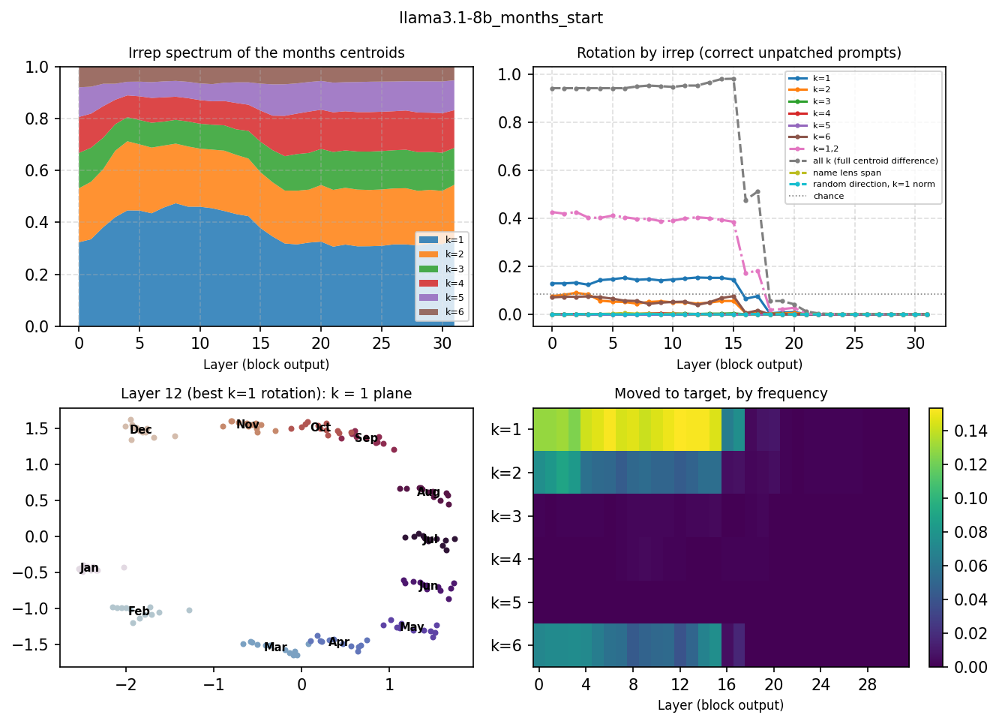
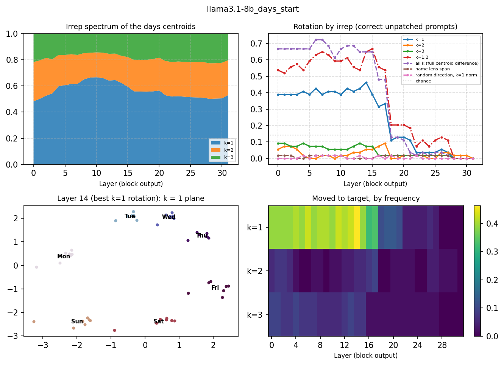

# 05 · Which irreducible representations of Z/n carry the answer?

**Question.** Engels et al. (2025) patch the 2-dim circle of the weekday/month representation. The n centroids
of the days (months) span the regular representation of Z/n minus its trivial part, which splits into real
irreps: a plane for each frequency k < n/2, and a line at k = n/2 when n is even. Which of these frequencies
does the model use to compute "two months from January"? And is the k = 1 circle a regular polygon, as an
equivariant (rotation-like) code would give?

```bash
python experiments/05_cyclic_irreps/cyclic_irreps.py --model llama3.1-8b --concept months --position start
```

`--concept days|months`, `--position start|last` (the named day/month, Engels' `a_token`, or the last token).
Outputs: `results/<model>_<concept>_<position>_{layers,rotation}.csv`, `figures/…`.

## Method

Engels et al.'s prompts: *"Let's do some calendar math. Two months from January is"* (12 months × durations
1–12) and *"Let's do some days of the week math. Two days from Monday is"* (7 × 7). Centroids and Fourier bases
come from odd durations; patches are evaluated on even ones.

- **Irrep spectrum:** the share of the centroids' energy in each frequency k.
- **Polygon regularity** in the k = 1 plane: cyclic order, spread of the angle gaps around 2π/n, spread of the radii.
- **Rotation by irrep:** add *P_K (c_{s+r} − c_s)* at the position after block *l*, for K = {k} for each k,
  K = {1, 2}, and all k (the full centroid difference); controls: the span of the n lens directions of the names
  and a random direction with the k = 1 patch's norm. Success = the answer moves from *a* to *a + r*,
  averaged over r = 1, …, n − 1, on held-out prompts the model solves.

## Results (Llama-3.1-8B, months, month token)

The model picks the right month among the 12 in 93.8% of the 144 prompts (93.1% of the held-out ones). Patches
every second layer; success = fraction of solved held-out prompts whose answer moves from *a* to *a + r*
(`results/llama3.1-8b_months_start_rotation.csv`, column `moved_if_correct_unpatched`; chance 1/12 = 0.08).

| Patch (layers 0–14) | Moves the answer | Patch norm / full norm |
|---|---|---|
| all k (full centroid difference) | **0.94–0.98** | 1 |
| k = 1 (Engels' circle) | 0.13–0.15 | 0.54–0.67 |
| k = 2 | 0.05–0.09 | 0.43–0.50 |
| k = 1, 2 | 0.39–0.43 | 0.72–0.83 |
| k = 3, 4, 5 (each) | 0.00 | 0.25–0.35 |
| k = 6 (the line: even/odd month) | 0.04–0.07 | 0.20–0.24 |
| span of the 12 month-name lens directions | 0.00 | 0.17–0.31 |
| random direction, k = 1 norm | 0.00 | 0.54–0.67 |

From layer 16 on, no patch at the month token works (full difference 0.48 at layer 16, ≤ 0.05 from layer 18):
the month has been moved to later positions.



- **The circle is there but does not carry the answer by itself.** The k = 1 plane holds 32–47% of the
  centroids' energy (a one-hot code would give 18%), most in layers 3–12, and the 12 months lie in calendar
  order at every layer. But the polygon is not regular (the angle gaps spread by 0.21–0.39 of 2π/12, the radii
  by 8–20% of their mean), and rotating along it moves only 13–15% of the
  answers, against 94–98% for the full centroid difference.
- **The frequencies act jointly, not additively.** k = 1 and k = 2 alone move 0.15 and 0.05; together 0.40.
  k = 3, 4, 5 alone move nothing, yet the full difference adds 0.55 to k = {1, 2} with only 17–28% more norm.
  An equivariant code, where adding *r* months is a rotation of one plane, would let k = 1 alone do the job.
  The model behaves more like a lookup over all frequencies, of which the circle is the largest part.
- **The month is not read through its lens directions here.** The projection of the centroid difference on the
  span of the 12 month-name lens vectors moves nothing at any layer, as for the days in experiment 02, while for
  countries in experiment 04 the lens span did 0.29–0.44 at the capital token from layer 5. Nameable entities
  live in the J-space; the cyclic quantity used for arithmetic does not.

## Results (Llama-3.1-8B, days, day token)

Engels' days prompt is hard for the model: it solves 51% of the 49 prompts and 9 of the 21 held-out ones, so
each cell below averages 9 prompts × 6 shifts (`results/llama3.1-8b_days_start_rotation.csv`; chance 1/7).

| Patch (layers 0–15) | Moves the answer | Patch norm / full norm |
|---|---|---|
| all k (full centroid difference) | 0.61–0.72 | 1 |
| k = 1 (the circle) | **0.39–0.46** | 0.68–0.81 |
| k = 1, 2 | 0.52–0.67 | 0.89–0.93 |
| k = 2 | 0.00–0.07 | 0.49–0.56 |
| k = 3 | 0.06–0.09 | 0.40–0.47 |
| span of the 7 day-name lens directions | 0.00–0.02 | 0.14–0.22 |
| random direction, k = 1 norm | 0.00–0.02 | 0.68–0.81 |



- **For the days the circle does more of the work**: k = 1 gives 0.39–0.46 of the full 0.61–0.72 (about
  60%), against 15% for the months. The k = 1 plane also holds more energy (48–67%, one-hot 33%) and is a
  closer heptagon (angle gaps spread by 0.18–0.31 of 2π/7, radii by 13–19%).
- Same pattern as the months otherwise: other frequencies alone do nearly nothing, k = {1, 2} together does more
  than the sum, the lens span of the names does nothing, and every patch at the day token stops working at
  layers 16–18.
- Months vs days: the k = 1 circle carries about 60% of the effect for the 7 days and 15% for the 12 months.
  Two cycles cannot tell whether this is the number of values or the concept; other cycles (hours, letters,
  notes) would.

## Other models (months, month token, every second layer)

| Model | Solves (held-out) | all k | k = 1 | k = 1, 2 | k = 2 … 6 (each) | lens span | random |
|---|---|---|---|---|---|---|---|
| Llama-3.1-8B | 93.1% | 0.94–0.98 | 0.13–0.15 | 0.39–0.43 | ≤ 0.09 | 0.00 | 0.00 |
| Llama-3.1-8B-Instruct | 80.6% | 0.80–0.84 | 0.11–0.13 | 0.32–0.37 | ≤ 0.08 | ≤ 0.01 | ≤ 0.01 |
| Qwen3-8B (layers 0–20, every 4th) | 40.3% | 0.59–0.67 | 0.10–0.24 | 0.32–0.34 | ≤ 0.04 | ≤ 0.02 | ≤ 0.01 |
| OLMo-3-7B (layers 0–16, every 4th) | 80.6% | 0.92–0.93 | 0.15–0.19 | 0.35–0.45 | ≤ 0.08 | 0.00 | 0.00 |

Ranges over layers 0–14 for the Llamas (`results/<model>_months_start_rotation.csv`). Instruction tuning leaves
the picture unchanged: the k = 1 circle moves about one answer in eight, all frequencies together most of them.
Qwen3-8B solves only 40% of the held-out prompts (29), but shows the same pattern: k = {1, 2} carries about
half of what the full difference does, every other frequency alone nothing, and the patches stop working at the
month token between layers 20 and 24 (of 36). OLMo-3-7B matches the Llamas closely (k = 1 0.15–0.19, k = {1, 2} 0.35–0.45, all 0.92–0.93), with the
hand-off between layers 16 and 20. In four models, the circle alone moves at most a quarter of the answers and
the month-name lens span nothing.
