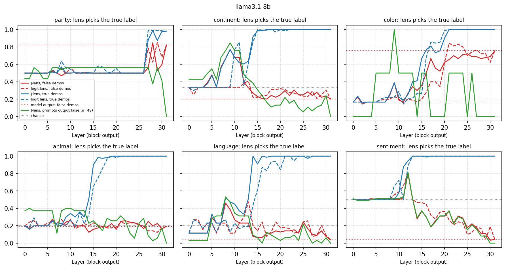
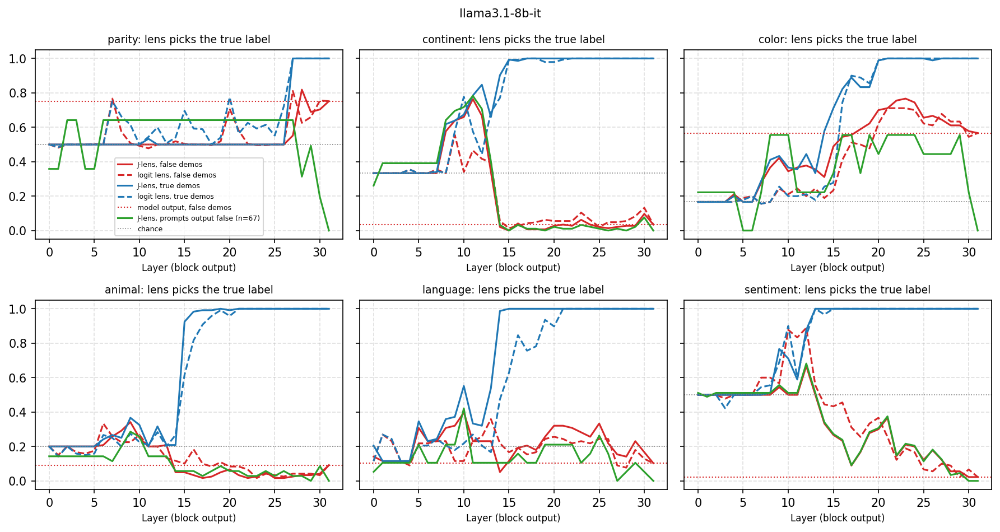

# 06 · Does the truth reach the workspace when the context pushes a falsehood?

**Question.** Halawi, Denain and Steinhardt (ICLR 2024, *Overthinking the Truth*) show that with wrong few-shot
labels, a model copies the wrong pattern, yet early-exit readouts at middle layers still pick the correct label
until "critical layers" override it. Read with the J-lens: does the true answer become verbalizable before the
model outputs the false one, and does the J-lens see it better or earlier than the logit lens? This is the
situation of an agent receiving adversarial context from another agent.

```bash
python experiments/06_false_context/false_context.py --model llama3.1-8b
```

Outputs: `results/<model>.csv` (task × condition × lens × layer), `results/<model>_final.csv` (model output),
`figures/<model>.{pdf,png}`.

## Method

Six tasks with 12 demonstrations each, true or with labels permuted consistently:

| Task | Format | Permutation |
|---|---|---|
| parity | *Number: 37 / Parity: odd* (10–99) | even ↔ odd |
| continent | *Country: France / Continent: Europe* (48 countries) | Europe → Asia → Africa → Europe |
| color | *Object: banana / Color: yellow* (30 objects) | red → yellow → green → blue → white → black → red |
| animal | *Animal: eagle / Class: bird* (40 animals) | mammal → bird → fish → insect → reptile → mammal |
| language | *Country: Brazil / Language: Portuguese* (26 countries) | French → Spanish → German → Portuguese → Arabic → French |
| sentiment | *Word: lovely / Sentiment: positive* (30 words) | positive ↔ negative |

Three demonstration samples per query. At the query's last token, every layer is read with both lenses,
restricted to the task's labels: *true* = the lens picks the true label, *false* = it picks the label the
demonstrations teach.

`results/<model>_when_output_false.csv` repeats the readout only on false-demonstration prompts where the model
outputs the taught (false) label: did the lens see the truth on the prompts where the model then says the
falsehood?

The tables for each model below cover the first three tasks (run first); the last section covers all six.

## Results (Llama-3.1-8B)

Model output with false demonstrations (`results/llama3.1-8b_final.csv`):

| Task | Outputs the true label | Outputs the taught (false) label |
|---|---|---|
| parity | 0.81 | 0.19 |
| continent | 0.21 | **0.62** |
| color | 0.76 | 0.02 |

Only the continent task makes the model follow the falsehood (with true demonstrations it is 98–100% right on
all three). On the **89 continent prompts where it outputs the false continent**, the lenses at the query's
last token pick the true continent with these frequencies (chance 1/3):

| Layer | 5 | 7 | 8 | 9 | 10 | 11 | 12 | 14 | 16 | 18 | 24 |
|---|---|---|---|---|---|---|---|---|---|---|---|
| J-lens | 0.51 | 0.69 | 0.76 | **0.87** | 0.76 | 0.78 | 0.48 | 0.38 | 0.25 | 0.09 | 0.09 |
| logit lens | 0.24 | 0.24 | 0.24 | 0.24 | 0.24 | 0.24 | 0.49 | 0.16 | 0.19 | 0.22 | 0.16 |



- **The truth is in the workspace before the model says the falsehood.** In layers 7–11 the J-lens reads the true
  continent on 69–87% of the prompts the model ends up answering falsely; the logit lens reads it on 24% (below
  chance). The truth fades in layers 12–18, where the taught label takes over: Halawi et al.'s "critical layers",
  seen here with the J-lens and not with the logit lens.
- On all continent prompts with false demonstrations, the J-lens picks the true continent at layers 8–11 about
  as often as with true demonstrations (0.67–0.78 vs 0.63–0.76): the false context does not change the early
  computation, it overrides it later.
- **Parity is not readable** with either lens before layer 27 (they pick the same label for every prompt), so
  this task says nothing about the workspace. Color: only 2 prompts output the false color, too few to condition on.

## Results (Llama-3.1-8B-Instruct)

With false demonstrations, the instruction-tuned model follows the falsehood on continents as often (0.64; true
0.03) and resists it on parity (0.74 true) and colors (0.58 true, 0.09 false). On the **92 continent prompts
where it outputs the false continent**, the J-lens picks the true one:

| Layer | 6 | 7 | 8 | 9 | 10 | 11 | 12 | 13 | 14 | 16 |
|---|---|---|---|---|---|---|---|---|---|---|
| J-lens | 0.38 | 0.38 | 0.62 | 0.68 | 0.72 | **0.77** | 0.70 | 0.39 | 0.04 | 0.03 |
| logit lens | 0.26 | 0.27 | 0.26 | 0.51 | 0.27 | 0.45 | 0.45 | 0.43 | 0.07 | 0.01 |



- **Same picture after instruction tuning**: the truth is in the workspace at layers 8–12 on prompts the model
  will answer falsely, and up to layer 11 the J-lens reads the true continent as often with false as with true
  demonstrations (0.57–0.76 vs 0.62–0.78).
- **The override is sharper**: from 0.70 at layer 12 to 0.04 at layer 14, against a fade over layers 12–18 in
  the base model.

## Six tasks, four models: the truth is there only if it forms before the override

The three tasks added later show when the result holds. For each model and task: how often the model follows the
falsehood, the first layer from which the J-lens reads the true label with true demonstrations (≥ 0.6 for three
consecutive layers), the layer from which it reads the taught label with false demonstrations (the override),
and, on prompts the model answers falsely, how often each lens picks the true label at its best layer. The
baseline is the best constant pick: the share of the most common true label among those prompts (a lens that
picks one label for every prompt gets that much). Tasks where the model rarely follows the falsehood (color) are
left out.

| Model | Task | Follows | Answered falsely | Truth readable from | Override from | J-lens best | Logit lens best | Baseline |
|---|---|---|---|---|---|---|---|---|
| Llama-3.1-8B | continent | 0.62 | 89 | 8 | 16 | **0.87** (9) | 0.49 (12) | 0.44 |
| | sentiment | 0.96 | 86 | 11 | 14 | **0.81** (12) | 0.81 (12) | 0.51 |
| | language | 0.38 | 30 | 14 | – | 0.50 (8) | 0.53 (13) | 0.33 |
| | animal | 0.27 | 32 | 15 | – | 0.44 (1) | 0.50 (12) | 0.50 |
| | parity | 0.19 | 52 | 27 | – | 0.60 (6) | 0.60 (7) | 0.58 |
| Llama-3.1-8B-Instruct | continent | 0.64 | 92 | 8 | 14 | **0.77** (11) | 0.51 (9) | 0.38 |
| | sentiment | 0.97 | 87 | 12 | 14 | 0.68 (12) | 0.89 (10) | 0.51 |
| | language | 0.24 | 19 | 14 | – | 0.42 (10) | 0.42 (1) | 0.42 |
| | animal | 0.28 | 34 | 15 | – | 0.29 (9) | 0.59 (16) | 0.68 |
| | parity | 0.26 | 69 | 27 | – | 0.62 (2) | 0.78 (7) | 0.62 |
| Qwen3-8B (36 layers) | continent | 0.59 | 85 | 16 | 23 | **0.82** (19) | 0.71 (12) | 0.51 |
| | sentiment | 0.82 | 74 | 12 | 24 | **0.95** (14) | 0.78 (19) | 0.51 |
| | language | 0.29 | 23 | 14 | – | **0.91** (15) | 0.78 (11) | 0.52 |
| | animal | 0.48 | 57 | 23 | – | 0.56 (18) | 0.70 (14) | 0.30 |
| | parity | 0.67 | 181 | 27 | 30 | 0.78 (17) | 0.76 (17) | 0.73 |
| OLMo-3-7B | continent | 0.53 | 76 | 18 | – | **0.96** (11) | 0.49 (1) | 0.50 |
| | sentiment | 0.46 | 41 | 14 | – | 0.78 (18) | 0.83 (10) | 0.68 |
| | language | 0.24 | 19 | 17 | – | 0.74 (23) | 0.74 (5) | 0.74 |
| | animal | 0.28 | 34 | 17 | – | 0.38 (9) | 0.41 (1) | 0.44 |

("–": the J-lens never picks the taught label on most false-demonstration prompts.)


- **It is a race.** In the Llamas the override comes at layers 14–16. Continent (readable from layer 8) and
  sentiment (11–12) form before it, and on prompts answered falsely the truth is in the workspace well above
  the baseline (continent 0.77–0.87 vs 0.38–0.44). Language and animal form at layers 14–15 and their readouts
  beat the baseline little (language 0.50 vs 0.33 in the base model, on 30 prompts) or not at all: the context
  wins before the answer exists.
- **Qwen3-8B overrides later** (layers 23–30 of 36) and its continent, sentiment and language labels form at
  layers 12–16, so all three have a window: the J-lens reads the true language on 91% of the prompts answered
  falsely (baseline 0.52), the true sentiment on 95% (0.51), the true continent on 82% (0.51). Qwen also
  follows false demonstrations more (parity 0.67, sentiment 0.82).
- **OLMo-3-7B** follows false demonstrations less (continent 0.53, sentiment 0.46, parity 0.01). Its continent
  readout has two stages: a brief one at layer 11, where the J-lens reads the true continent on 96% of the 76
  prompts answered falsely (baseline 0.50; the logit lens sees nothing), and the full retrieval at layer 18,
  which comes after the false context has taken over (with false demonstrations the truth is read on 18% at
  layer 18). The early stage is the one the J-lens catches.
- **J-lens vs logit lens** depends on the task: for continents the J-lens wins in all four models (0.77–0.96 vs
  0.49–0.71); for sentiment in Llama-Instruct the logit lens does better (0.89 vs 0.68).
- **Parity is not readable** before layer 27 in any model; its readouts match the constant-pick baseline.
- With true demonstrations every task is answered correctly (98–100%), so the late-forming labels are known; they
  are just computed after the override.
